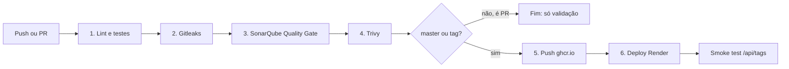
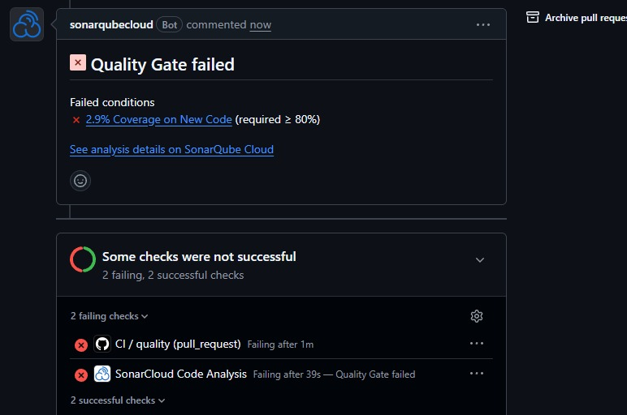
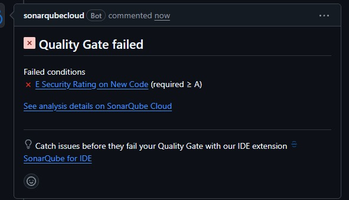
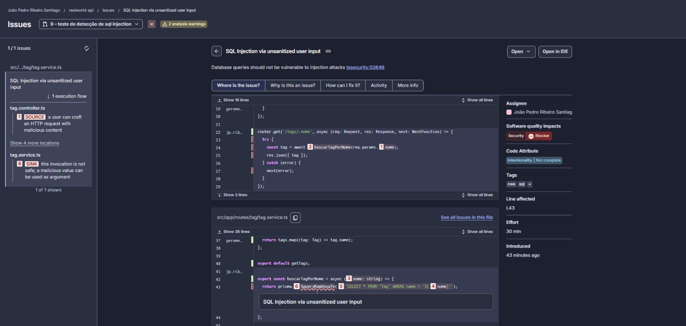

# RealWorld API: CI/CD

API do Conduit (clone do Medium) em Node.js + Express + TypeScript + Prisma + PostgreSQL, baseada em gothinkster/node-express-realworld-example-app, com pipeline no GitHub Actions e deploy automático no Render.

Produção: https://realworld-comp-api.onrender.com
Link Do Vídeo: https://youtu.be/KVBzBfpTBA8

## Como rodar

    docker run -d --name realworld-db -p 5432:5432 -e POSTGRES_USER=realworld \
    -e POSTGRES_PASSWORD=realworld -e POSTGRES_DB=realworld postgres:16-alpine

    docker exec realworld-db createdb -U realworld realworld_test

    cp .env.example .env

    npm ci && npx prisma migrate deploy

    npm run test:coverage

## O que mudei no projeto original (e por quê)

- Ordem do mock do Prisma (7 testes quebrados no original): testes isolados.
- app.ts separado do main.ts: app testável com Supertest.
- JWT_SECRET obrigatório (fail fast), sem valor padrão no código.
- npm audit fix e Express 4.22 (11 pacotes vulneráveis → 0 em produção).
- ESLint 8 via Nx (33 erros) → ESLint 9 flat config + Prettier (0 erros).
- .npmrc com legacy-peer-deps, para o conflito de versão do Nx.
- Cobertura de 25,8% → 92% de linhas, com testes de integração num banco separado.

## Arquitetura da pipeline

## Decisões de segurança

- Segredos só em GitHub Secrets/Environments e no Render; Gitleaks varre a história inteira.
- Imagem multi-stage em Alpine, sem npm, rodando como usuário não-root.
- Trivy bloqueia HIGH/CRITICAL antes do push; a imagem publicada é a escaneada.
- Permissões mínimas; packages: write só no job de push.
- Actions de segurança fixadas por hash de commit.
- Deploy pela tag sha-<commit>: rastreável e com rollback.

## Quality Gate

"Sonar way" (80% de cobertura no código novo, mais rígido que os 70% do desafio),
sonar.qualitygate.wait=true,

## Fluxo de branches

GitHub Flow: branch → PR (etapas 1 a 4) → merge na main (1 a 6) → tag vX.Y.Z.

## Limitações e melhorias futuras

### Aplicação

- **Sem rate limiting nem headers de segurança:** o CORS aceita qualquer origem e não há `helmet` nem limite de requisições, inclusive no login. Melhoria: `express-rate-limit`, `helmet` e CORS restrito.
- **JWT sem revogação:** o token vale 60 dias e não há refresh token nem logout no servidor.
- **Paginação sem teto:** `?limit=100000` é aceito. Melhoria: limitar a um máximo, como 100.
- **Validação manual:** não há regras de formato de e-mail nem de tamanho mínimo de senha. Melhoria: schemas com `zod`.
- **Erros 500 devolvem `err.message`** ao cliente. Melhoria: mensagem genérica para o cliente e o detalhe só no log.
- **Observabilidade mínima:** não há logs estruturados, métricas nem um `/health` que teste o banco.
- **Dependências antigas:** Prisma 4 e Nx 17.

### Testes

- A pasta `e2e/` é o template do Nx, está desatualizada (espera "Hello API") e não roda na pipeline.
- Não há testes de carga nem de contrato com a coleção Postman oficial do RealWorld.

### Pipeline e deploy

- Os jobs são todos sequenciais. O Gitleaks poderia rodar em paralelo ou primeiro.
- As migrations rodam antes do deploy e não há rollback. Se o deploy falhar, o banco já foi migrado. Melhoria: migrations expand/contract e um job que volte o Render para a tag `sha-` anterior.
- O smoke test só verifica `GET /api/tags`.
- Não há staging: o deploy vai direto para produção.
- A imagem não é assinada e não tem SBOM (dá para resolver com `cosign`).
